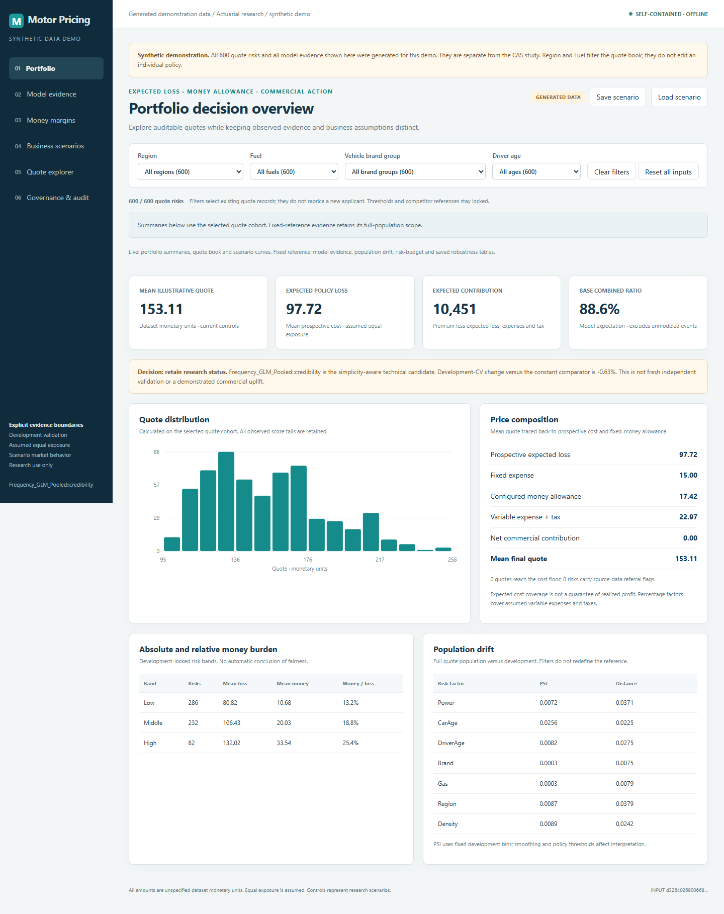

# Motor Insurance Pricing

A motor pricing study using a CAS program dataset of 111,617 policy records. It compares GLM, GAM and GBM approaches, then separates expected claims cost, expenses and fixed monetary margins when constructing quotes.

## Try the dashboard

Download the repository and open `index.html` in Chrome or Edge. The [standalone demo](demo/DASHBOARD.html) uses 600 generated risks and works offline. Region and Fuel filter the portfolio, and all charts render locally. [Demo guide](docs/DEMO.md). GitHub's file preview displays source; it does not run the dashboard.



## Pricing questions

How much model complexity does the claims information support? How should large losses affect the price? What happens to growth and contribution when a monetary allowance is changed and competitor prices are unknown?

The development comparison selected GLM frequency with pooled severity and credibility calibration. More granular severity models were retained as challengers. In the assumed market scenarios, none of the tested actions met both the growth target and the worst expected-contribution requirement.

## Included here

- Python research, pricing rules and offline dashboard template.
- Native R models and frozen-model scoring code.
- Excel workbook builder and formula verification code.
- Synthetic checks for model, calibration, exposure and financial calculations.

The included demo uses generated data. The complete local study also includes its real-data dashboard, workbook and reports. Those data-bearing files are excluded from this source selection. Its historical cross-format checks covered 10,000 quotes and 216 deterministic pricing scenarios; they establish calculation agreement, not future profit.

## Run the synthetic checks

Tested with Python 3.14.7. Package versions are in `project/requirements.lock.txt`.

```sh
python -m pip install -r project/requirements.lock.txt
cd project
python -m pytest test_v2.py -q
```

Tests that require empirical output files skip when those files are absent.

For the R exposure and schema checks, use R with the recommended `rpart` and `splines` packages. Tested with R 4.6.1.

```sh
cd project/r_version
Rscript test_generic_R.R
```

## Reproducing the empirical study

The original workbook and frozen split manifests are required. A source clone alone cannot reproduce the reported real-data results. See [Reproduction](docs/REPRODUCTION.md) for the required inputs and execution order, and [Method](docs/METHOD.md) for the modeling choices.

## Boundaries

Exposure, valuation dates, currency, policy terms and observed conversion data were unavailable. Equal exposure is an assumption. Commercial responses are scenarios rather than estimated customer behavior. Previously explored test data were quarantined; this version does not claim fresh independent or out-of-time validation.

R's native GBM uses a different tree implementation from Python. Exact scoring agreement refers to the selected frozen GLM. Excel scores that model and evaluates financial rules; it does not train the model candidates. Workbook checks were performed offline without automated Microsoft Excel recalculation.

See [Calculation checks](docs/VALIDATION.md) for the scope of the original checks and the checks on this source selection.
